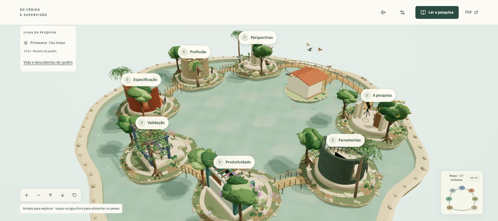

# Do código à supervisão

**Se a IA escreve código, o que cabe a nós?**

Um TCC sobre inteligência artificial generativa e desenvolvimento de software, apresentado como um arquipélago interativo. Sete ilhas conectam a pesquisa, suas evidências e as mudanças no papel do desenvolvedor, em um jardim que continua vivo enquanto você explora.

**[Explorar o site →](https://tcc-pdrarth.vercel.app/)** · [Ler a pesquisa](https://tcc-pdrarth.vercel.app/#caderno/pesquisa) · [Abrir o TCC em PDF](https://tcc-pdrarth.vercel.app/tcc-pedro-arthur.pdf)

[](https://tcc-pdrarth.vercel.app/)

## A pesquisa

O trabalho de **Pedro Arthur Oliveira Januário** é uma revisão narrativa da literatura com apoio documental sobre produtividade, limitações da IA generativa e transformação da prática profissional. Também discute *Spec-Driven Development* e *Harness Engineering*, com atenção à especificação, ao contexto, à supervisão e à validação das soluções.

Os resultados dos estudos são apresentados com seus métodos, contextos e limitações. A experiência 3D é uma forma de apresentar e explorar o TCC; não constitui um experimento de produtividade. As referências estão no [cadastro de fontes](src/lib/sources.json) e no texto acadêmico completo.

## Sete ilhas, um percurso

| Ilha | Tema |
| --- | --- |
| **01 · Pesquisa** | A pergunta, a hipótese e o percurso da revisão. |
| **02 · Ferramentas** | Da sugestão de código à delegação de tarefas. |
| **03 · Produtividade** | Evidências, métricas e diferenças entre contextos. |
| **04 · Validação** | Revisão, qualidade e Harness Engineering. |
| **05 · Especificação** | Contexto, critérios de aceitação e Spec-Driven Development. |
| **06 · Profissão** | Responsabilidade técnica, supervisão e formação. |
| **07 · Perspectivas** | Conclusões e perguntas para futuras investigações. |

Cada ilha abre uma síntese com explicações visuais e fontes. Para acompanhar o conteúdo em sequência, o botão **Ler a pesquisa** abre o caderno de leitura. Também estão disponíveis a [exploração em texto](https://tcc-pdrarth.vercel.app/explorar) e o [TCC completo em HTML](https://tcc-pdrarth.vercel.app/texto-completo).

## Um jardim vivo

- **Ambiente em transformação:** quatro estações, onze opções de clima e modo automático, passagem do dia para a noite, árvores ao vento e mudanças graduais na folhagem.
- **Água e fenômenos:** ondas, chuva, acúmulo de neve e gelo, transbordamento do lago, arco-íris e estrelas cadentes conforme as condições do jardim.
- **Animais com suas próprias rotinas:** peixes, aves, borboletas, patos, tartarugas e caranguejos; vagalumes aparecem nas noites de verão.
- **Ninhos e filhotes:** adultos cuidam dos ovos, que se abrem para dar lugar a até dois patinhos e dois passarinhos por sessão. Eles crescem aos poucos, sem multiplicar indefinidamente a população.
- **Um morador para acompanhar:** passeios pelas pontes, descanso, sono noturno, acenos e pesca em diferentes pontos. O visitante também pode escolher atividades e lugares.
- **Som e descobertas:** música em sequência aleatória, sons da natureza com áudio espacial, volumes separados e um caderno que registra os encontros do visitante.

Para experimentar, arraste a cena e use os controles de câmera. Em **Ambiente do jardim**, ajuste clima, estação, horário e som. O botão **Vida e descobertas do jardim**, abaixo do relógio, reúne atividades do morador, visita guiada e caderno de descobertas. Toque na água livre para alimentar os peixes ou no morador para receber um aceno quando ele estiver disponível.

## Tecnologias

| Parte | Implementação |
| --- | --- |
| Aplicação e interface | Next.js 16, React 19, TypeScript e Tailwind CSS. |
| Cena 3D | Three.js, React Three Fiber e Drei. |
| Modelos e recursos | Cenas autorais no Blender, modelos GLB e preparação de recursos por scripts. |
| Simulação | Módulos de comportamento para clima, água, fauna, ninhos e rotina do morador. |
| Verificação | Testes com o executor nativo do Node.js, TypeScript e ESLint. |
| Publicação | Vercel para o site público, com serviço editorial separado. |

A cena utiliza malhas instanciadas, recursos preparados e ajustes de qualidade conforme o dispositivo. Conteúdo e controles permanecem em HTML, com navegação por teclado e adaptação a telas menores.

## Executar localmente

Requisitos: **Node.js 24.x**, npm e Git.

```bash
git clone https://github.com/PdrArth/TCC-WEBSITE3D.git
cd TCC-WEBSITE3D
npm run install:ci
npm run dev
```

Abra [localhost:3000](http://localhost:3000). O instalador do projeto utiliza o arquivo de dependências travadas e prepara a instalação para o ambiente de execução.

A cena e o conteúdo acadêmico usam arquivos versionados. Não é necessário configurar um banco de dados para explorá-los localmente. As novidades publicadas, a revisão privada e uma das faixas de áudio dependem do serviço externo existente. A configuração opcional de `TCC_BACKEND_ORIGIN` está em [Publicação e serviço editorial](docs/deployment.md).

| Comando | Finalidade |
| --- | --- |
| `npm run dev` | Iniciar o servidor de desenvolvimento. |
| `npm test` | Verificar os comportamentos e contratos da aplicação. |
| `npm run lint` | Executar a análise estática com ESLint. |
| `npm run build` | Gerar a versão de produção. |
| `npm start` | Servir localmente a versão gerada pelo build. |

## Organização do repositório

```text
src/
  app/                    Páginas e rotas HTTP
  components/             Cena 3D, painéis de leitura e interface
  lib/                    Conteúdo, fontes e regras de comportamento
public/                   Modelos de execução, sons, imagens e PDF
assets/world/             Arquivos de criação do mundo 3D
infrastructure/           Integrações de hospedagem e serviço editorial
scripts/                  Preparação de recursos e manutenção
test/                     Testes de comportamento e contratos
docs/                     Arquitetura, pesquisa, créditos e validações
```

O site público é compilado com o Next.js nativo na Vercel. A infraestrutura do serviço editorial e os comandos de prévia do ambiente Sites têm documentação própria e ficam separados da aplicação pública.

## Documentação

- [Índice da documentação](docs/README.md): visão geral dos documentos do projeto.
- [Arquitetura](docs/architecture.md): responsabilidades dos módulos e fluxo dos recursos.
- [Publicação](docs/deployment.md): Vercel, serviço editorial e configuração do áudio.
- [Registros de validação](docs/validation/README.md): verificações e limites de cada versão, incluindo [animais e ninhos](docs/validation/garden-wildlife-20261113.md) e [crescimento dos filhotes](docs/validation/garden-families-20261113.md).
- [Créditos e licenças](docs/credits/README.md): autoria e proveniência dos modelos, texturas e sons.

## Autoria e condições de uso

Criado por **[Pedro Arthur Oliveira Januário](https://github.com/PdrArth)**, a partir de seu TCC sobre IA generativa e desenvolvimento de software.

As músicas de Genshin Impact e os demais recursos de terceiros mantêm suas próprias condições de uso, registradas nos [créditos](docs/credits/assets.md). Este repositório não concede uma licença geral de reutilização do código, do texto acadêmico ou dos modelos autorais.
