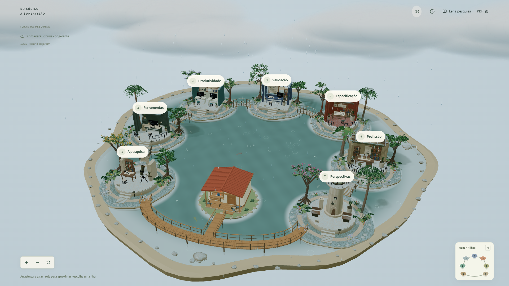

# Do código à supervisão

## Se a IA escreve código, o que muda no trabalho de quem desenvolve?

Este repositório contém o site que apresenta o TCC de Pedro Arthur Oliveira Januário e o PDF do trabalho. A pesquisa analisa o que estudos acadêmicos e documentos técnicos dizem sobre produtividade, erros, retrabalho e mudanças na prática de desenvolvimento de software.

A resposta não é igual em todos os cenários. Os estudos avaliam tarefas, participantes e métricas diferentes; por isso, o site preserva essas diferenças e não transforma um resultado isolado em regra geral. A pesquisa também discute por que especificar o problema, revisar o código e validar a solução continuam sendo parte central do trabalho.

[Explorar as sete ilhas](https://do-codigo-a-supervisao-pedro.pdrarth.chatgpt.site/) · [Ler o TCC em PDF](https://do-codigo-a-supervisao-pedro.pdrarth.chatgpt.site/tcc-pedro-arthur.pdf)

## Sete temas, uma pergunta

1. **A pesquisa** — problema, hipótese e percurso da revisão.
2. **Ferramentas** — como as ferramentas de programação com IA ampliaram o que pode ser delegado.
3. **Produtividade** — ganhos observados e diferenças entre velocidade percebida e resultado real.
4. **Validação** — revisão, testes, qualidade e custo do retrabalho.
5. **Especificação** — critérios, contexto e *Spec-Driven Development*.
6. **Profissão** — o que muda na atuação e nas responsabilidades de quem desenvolve.
7. **Perspectivas** — conclusões do TCC e perguntas para trabalhos futuros.

O arquipélago é uma forma de percorrer os capítulos, não um experimento de produtividade. Cada ilha apresenta uma síntese e suas fontes; a leitura completa e o PDF preservam o desenvolvimento acadêmico.

## Organização do repositório

| Caminho | O que reúne |
| --- | --- |
| `app/` | Páginas e rotas da aplicação. |
| `components/` | Interface, caderno de leitura e cena 3D. |
| `lib/` | Conteúdo, contratos e regras compartilhadas. |
| `assets/world/` | Arquivos editáveis do mundo, texturas e manifestos de origem. |
| `public/` | Recursos servidos pelo site, incluindo o PDF do TCC. |
| `scripts/world/` | Preparação e validação dos recursos 3D. |
| `db/`, `drizzle/`, `examples/` | Esquema, migrações e integração de banco. |
| `test/` | Testes e dados sintéticos usados por eles. |
| `docs/` | Índice da documentação, registros de pesquisa, áudio, design, créditos e validações. |

O mapa da documentação está em [`docs/README.md`](docs/README.md), e o fluxo entre a cena autoral, os arquivos públicos e a aplicação está em [`docs/architecture.md`](docs/architecture.md). A aplicação combina React e TypeScript com Three.js e React Three Fiber; as páginas e serviços usam Vinext e Cloudflare.

## Créditos e direitos

Créditos, licenças e proveniência dos recursos visuais e sonoros estão separados em [`docs/credits/`](docs/credits/README.md). Os arquivos de imagem e evidência ficam em [`docs/assets/`](docs/assets/README.md), e os registros técnicos da trilha ficam em [`docs/audio/`](docs/audio/README.md).

O repositório não concede uma licença geral para reutilizar o código, o texto acadêmico ou os modelos autorais. Recursos de terceiros permanecem sujeitos às condições registradas em seus créditos.
