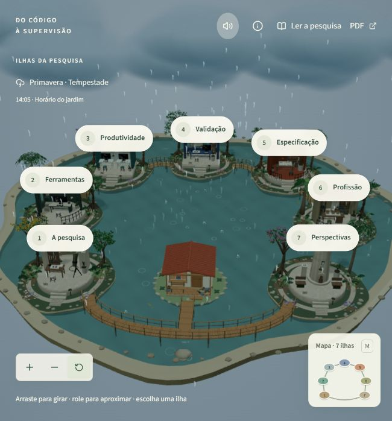

# Do código à supervisão

**Uma pesquisa sobre IA generativa e o trabalho de quem desenvolve software, apresentada como um arquipélago interativo.**

[Explorar o site publicado](https://do-codigo-a-supervisao-pedro.pdrarth.chatgpt.site/) · [Baixar o TCC em PDF](https://do-codigo-a-supervisao-pedro.pdrarth.chatgpt.site/tcc-pedro-arthur.pdf)



## Sobre o projeto

Este site apresenta o TCC de Pedro Arthur Oliveira Januário sobre os efeitos da inteligência artificial generativa no desenvolvimento de software. A pesquisa discute produtividade, limites e retrabalho, qualidade, especificação e a transformação do papel do desenvolvedor. O conteúdo parte de uma revisão narrativa da literatura com apoio documental; a experiência visual é uma forma de apresentar a pesquisa, não um experimento que mede produtividade.

O visitante pode explorar sete ilhas — **Pesquisa, Ferramentas, Produtividade, Validação, Especificação, Profissão e Perspectivas** — ou ler o caderno completo. Os temas preservam diferenças de método, tarefa e métrica entre os estudos. A cena também mostra um pequeno ecossistema com morador, aves, peixes, clima e estações.

## O que você encontra

- Mapa 3D navegável com sete temas e uma leitura direta equivalente.
- Resumos editoriais, comparações e referências ligadas às fontes.
- Caderno completo e PDF do trabalho acadêmico.
- Clima e estações como recursos visuais, com acessos por teclado e suporte a movimento reduzido.
- Área privada de revisão de novidades, protegida pela autenticação do serviço de hospedagem.

## Tecnologias

React 19, TypeScript, Vinext, Three.js, React Three Fiber, Tailwind CSS, Cloudflare Workers, D1 e Drizzle ORM.

## Executar localmente

Requer Node.js 22.13 ou superior e npm. Na raiz do projeto:

```bash
npm ci
npm run dev
```

O comando informa o endereço local. Algumas rotas dependem do ambiente compatível com Cloudflare e de variáveis locais; credenciais de produção não fazem parte deste repositório. Para validar o código, os comandos disponíveis são:

```bash
npm test
npm run lint
node node_modules/typescript/bin/tsc --noEmit
npm run build
```

O teste de integração editorial grava somente quando recebe explicitamente um banco isolado e um servidor em `127.0.0.1`; consulte o próprio teste antes de executá-lo manualmente.

## Organização

| Pasta | Conteúdo |
| --- | --- |
| `app/` | Páginas e rotas da aplicação. |
| `components/` | Interface, caderno, ilha e experiência 3D. |
| `lib/` | Conteúdo editorial, contratos, clima, áudio e navegação. |
| `db/` e `drizzle/` | Acesso ao banco e migrações. |
| `assets/world/` | Cenas editáveis do Blender, texturas, proveniência e instruções de reconstrução. |
| `public/` | PDF, modelos, imagens, fontes e recursos estáticos. |
| `scripts/` | Preparação de recursos e tarefas de desenvolvimento. |
| `test/` | Testes automatizados e dados sintéticos de teste. |
| `docs/` | Créditos, decisões visuais, validação e evidências do projeto. |

## Créditos e arquivos de mídia

A autoria e as condições dos recursos de terceiros estão documentadas em [`docs/asset-credits.md`](docs/asset-credits.md) e nos manifestos junto aos recursos. As fontes tipográficas, texturas, efeitos de interface e sons ambientais têm seus créditos ou licenças registrados nesses arquivos.

O MP3 de Genshin Impact usado pela versão atualmente publicada **não está incluído neste repositório**: a música tem direitos reservados e as condições consultadas não autorizam espelhar o arquivo. O manifesto ainda espera esse arquivo no caminho `/experience/audio/genshin-official-theme.mp3`; para rodar uma cópia local com música, forneça um recurso para o qual você tenha autorização e atualize o manifesto e o áudio inicial. A versão pública do site permanece disponível no link acima.

Sugestões ainda não aprovadas e configurações locais também não são versionadas. Os testes usam registros fictícios em `test/fixtures/`.

## Direitos de uso

Este repositório é público para consulta. Não há uma licença geral concedendo reutilização do código, do texto acadêmico ou dos modelos autorais. Recursos de terceiros permanecem sujeitos às licenças indicadas em seus créditos.
