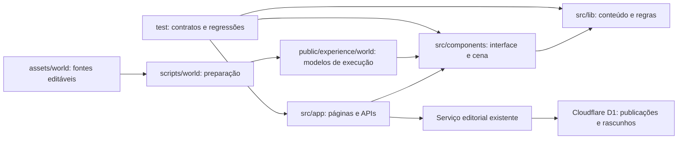

# Arquitetura da aplicação

O código executado pelo site fica em `src/`. Recursos publicados, arquivos de criação e infraestrutura têm diretórios próprios, para que a raiz não misture páginas do Next.js com migrações de banco ou ferramentas da hospedagem anterior.

| Diretório | Responsabilidade |
| --- | --- |
| `src/app/` | Páginas, layout e rotas HTTP do Next.js. |
| `src/components/island-experience/` | Cena, ambiente, fauna, morador e interação com as ilhas. |
| `src/components/research-content/` | Painéis e caderno de leitura. |
| `src/components/ui/` | Componentes de interface reutilizáveis. |
| `src/lib/` | Conteúdo editorial, cadastro de fontes, contratos e regras compartilhadas. |
| `src/lib/experience/` | Navegação, clima, estações, áudio e rotina do morador. |
| `src/hooks/` e `src/types/` | Hooks compartilhados e declarações de tipos. |
| `public/` | Recursos com URL pública: modelos de execução, imagens, sons e PDF. |
| `assets/world/` | Cenas editáveis, texturas e manifestos usados na criação dos modelos. |
| `infrastructure/` | Código de integração do serviço editorial e da hospedagem Sites. |
| `scripts/` | Preparação do mundo, verificações e ferramentas da hospedagem anterior. |
| `test/` | Testes de comportamento e fixtures sintéticas. |

O alias `@/` aponta para `src/`. Assim, os componentes não dependem da posição física de uma página dentro da árvore de rotas. As configurações descobertas automaticamente pelo Next.js, TypeScript, ESLint, PostCSS e Vercel permanecem na raiz.

## Aplicação pública e serviço editorial

A Vercel compila `src/app/` com o Next.js nativo. A pesquisa consolidada e suas fontes são versionadas em `src/lib/`; novidades aprovadas são consultadas no serviço editorial existente. O código D1, as migrações e os exemplos desse serviço estão agrupados em `infrastructure/editorial/`, fora da compilação Next.js.

O suporte ao ambiente Sites fica em `infrastructure/sites/` e `scripts/sites/`. O arquivo `vite.config.ts` da raiz é apenas um ponto de entrada para essa configuração, necessário para a descoberta automática do Vinext; ele não participa do build da Vercel. Veja [Infraestrutura](../infrastructure/README.md) e [Publicação](deployment.md).

## Recursos e documentação

Os scripts em `scripts/world/` preparam os arquivos de `assets/world/` para publicação em `public/experience/world/`. Essa separação mantém arquivos editáveis e relatórios fora do caminho de carregamento da experiência. Nenhum arquivo privado de configuração da hospedagem é incluído no repositório.

O [índice da documentação](README.md) separa pesquisa, design, áudio, créditos e validações. Relatórios antigos preservam os caminhos e o contexto das versões em que foram escritos; o mapa acima descreve a estrutura atual.
