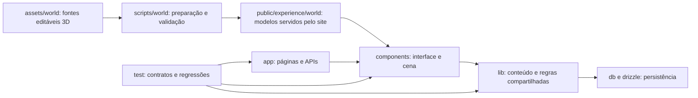

# Arquitetura da aplicação

O repositório segue a organização do framework: rotas ficam em `app/`, a interface em `components/`, as regras compartilhadas em `lib/` e os arquivos públicos em `public/`. Os diretórios de domínio dentro de `components/` e `lib/` separam a experiência das ilhas, o caderno de leitura e os contratos de ambiente.

`assets/world/` guarda cenas editáveis, texturas e seus manifestos. Os scripts correspondentes preparam os modelos que a aplicação carrega de `public/experience/world/`; o diretório `public/` contém apenas os recursos necessários em tempo de execução. Os testes usam fixtures sintéticas em `test/fixtures/`, separadas dos dados editoriais.

O mapa dos documentos e registros do projeto está em [`README.md`](README.md). Os créditos de mídia ficam em [`credits/`](credits/README.md), fora dos relatórios de validação.
